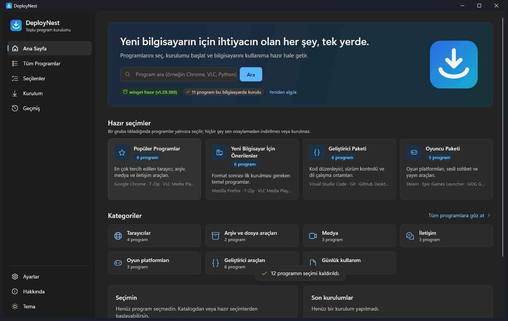
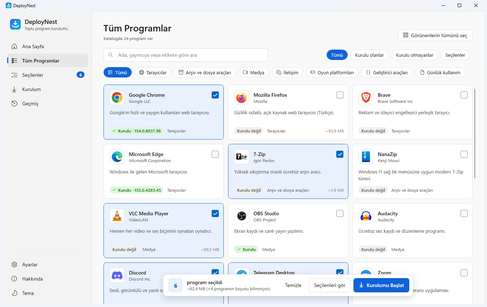
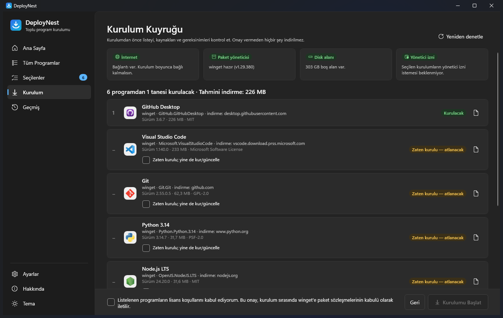
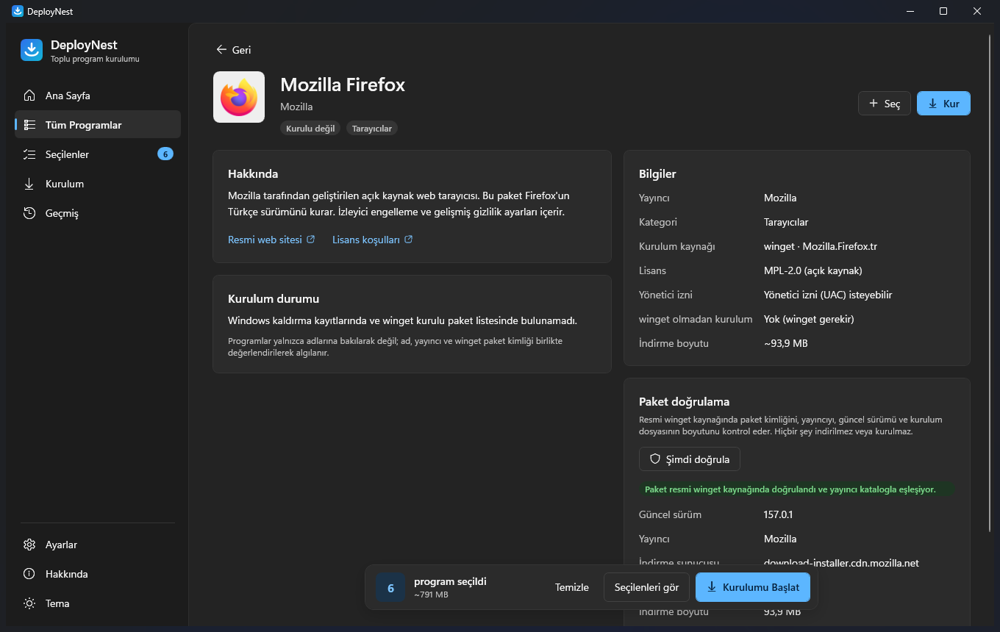

<p align="center">
  
</p>

<h1 align="center">DeployNest</h1>

<p align="center">
  <strong>Yeni bilgisayarın için ihtiyacın olan her şey, tek yerde.</strong><br>
  Programlarını seç, kurulumu başlat ve bilgisayarını kullanıma hazır hale getir.
</p>

<p align="center">
  <a href="https://github.com/efebalci569-dot/DeployNest/actions/workflows/ci.yml"></a>
  
  
  
</p>

---

## Proje açıklaması

**DeployNest**, Windows 10 ve Windows 11 için geliştirilmiş, açık kaynak bir **toplu program kurulum uygulamasıdır**. Yeni bir bilgisayar aldığında ya da format attığında ihtiyaç duyduğun programları tek tek aramak, indirmek ve kurmak yerine; istediklerini seçip tek bir işlemle, **resmi kaynaklardan ve doğrulayarak** kurmanı sağlar.

Uygulama C# / .NET 10 LTS ve WPF ile MVVM mimarisinde yazılmıştır. Programları öncelikle Microsoft'un resmi **Windows Paket Yöneticisi (winget)** üzerinden kurar; winget yoksa katalogda doğrudan indirme tanımı bulunan programları yayıncının resmi adresinden indirip **SHA-256 ve/veya Authenticode imzası** doğrulamasından geçirdikten sonra kurar.

🌐 **Web sitesi:** https://deploynest.vercel.app (kaynak: `website/` klasörü, Vercel ile yayımlanır)

## Özellikler

- **24 doğrulanmış program, 7 kategori** — tarayıcılar, arşiv araçları, medya, iletişim, oyun platformları, geliştirici araçları ve günlük kullanım. Her kaydın winget paket kimliği ve yayıncısı resmi kaynakta doğrulanmıştır.
- **JSON tabanlı katalog** — program listesi kodun içinde değil, `catalog/software.json` dosyasındadır; geçersiz kayıtlar uygulamayı bozmadan reddedilir.
- **Hızlı arama ve filtreler** — yazdıkça güncellenen, büyük/küçük harf ve Türkçe karakter toleranslı arama (`sikistirma` → “sıkıştırma”); kategori, kurulu/kurulu olmayan ve seçilen filtreleri.
- **Hazır seçim grupları** — “Popüler Programlar”, “Yeni Bilgisayar İçin Önerilenler”, “Geliştirici Paketi”, “Oyuncu Paketi”. Gruplar yalnızca seçim yapar; onayın olmadan hiçbir şey indirilmez.
- **Kurulu program algılama** — Windows kaldırma kayıtları (64-bit, 32-bit, kullanıcı) ve `winget export` listesi; eşleşme ad + yayıncı + paket kimliğiyle yapılır, yalnızca ada bakılmaz. Durumlar: *Kurulu*, *Kurulu değil*, *Durum doğrulanamadı*.
- **Kurulum öncesi doğrulama ekranı** — her paket resmi winget kaynağında kimlik/yayıncı eşleşmesiyle doğrulanır; sürüm, indirme sunucusu, gerçek indirme boyutu, lisans, disk alanı, internet ve olası yönetici izinleri gösterilir. Lisans onayı olmadan kurulum başlamaz.
- **Gerçek toplu kurulum motoru** — kuyruk halinde, sırayla kurulum; bir program başarısız olsa da diğerleri devam eder; aynı program iki kez kurulmaz; kurulumdan sonra programın gerçekten kurulu olduğu yeniden denetlenir.
- **İlerleme ve iptal** — her program için aşama (hazırlanıyor, indiriliyor, doğrulanıyor, kuruluyor) ve mümkün olduğunda yüzde; “bekleyenleri iptal et” (çalışan kurulum güvenle biter) veya “hemen durdur”.
- **Anlaşılır hata yönetimi** — internet kesintisi, sunucu hatası, eksik indirme, hash/imza hatası, winget yokluğu, reddedilen yönetici izni, dolu disk, açık program, kuruluş ilkesi ve daha fazlası için Türkçe açıklama + “ne yapabilirsin” önerisi.
- **Rapor ve geçmiş** — oturum sonunda başarılı/başarısız/atlanan/iptal edilenleri içeren rapor (otomatik kaydedilir, `.txt` olarak dışa aktarılabilir) ve temizlenebilir kurulum geçmişi.
- **Modern arayüz** — Windows 11 Fluent görünümü, açık/koyu tema, gerçek program logoları, akıcı ama ölçülü animasyonlar, tamamen Türkçe arayüz ve yeni diller için dil dosyası altyapısı.
- **Ayarlar** — tema, dil, indirme klasörü, eşzamanlı indirme sayısı, indirilen dosyaları saklama, kurulu programları atlama, günlük klasörü, sürüm ve güncelleme denetimi, gizlilik/güvenlik bilgileri.

## Ekran görüntüleri

| Ana sayfa | Tüm programlar |
| --- | --- |
|  |  |
| **Kurulum öncesi doğrulama** | **Program ayrıntıları** |
|  |  |

## Sistem gereksinimleri

- Windows 10 veya Windows 11, **64 bit (x64)**
- İnternet bağlantısı
- **Önerilen:** Windows Paket Yöneticisi (winget) 1.6 veya üzeri. Windows 11'de hazır gelir; Windows 10'da Microsoft Store'daki [Uygulama Yükleyicisi (App Installer)](https://apps.microsoft.com/detail/9NBLGGH4NNS1) ile kurulur. winget yoksa yalnızca doğrudan indirme tanımı olan programlar (Google Chrome, 7-Zip, Node.js LTS, Everything) kurulabilir.
- Yayımlanan EXE, .NET çalışma zamanını içinde taşır; ayrıca .NET kurmana gerek yoktur.

## Kurulum ve kullanım rehberi

1. [GitHub Releases](https://github.com/efebalci569-dot/DeployNest/releases) sayfasından `DeployNest-<sürüm>-win-x64.exe` dosyasını indir. Kurulum gerektirmez; istediğin klasörden çalıştırabilirsin. (Taşınabilir `.zip` paketi de aynı EXE'yi içerir.)
2. EXE henüz kod imzalı olmadığı için Windows SmartScreen “Bilgisayarınız korundu” uyarısı gösterebilir. Dosyayı yalnızca resmi bağlantıdan indirdiysen **Ek bilgi → Yine de çalıştır** ile açabilirsin. `SHA256SUMS.txt` ile dosyanın bütünlüğünü doğrulayabilirsin:
   ```powershell
   Get-FileHash .\DeployNest-0.1.0-win-x64.exe -Algorithm SHA256
   ```
3. **Ana Sayfa**'da hazır bir grup seç veya **Tüm Programlar**'dan istediğin programları işaretle. Seçimin sayfalar arasında korunur.
4. **Kurulumu Başlat**'a bas. **Kurulum Kuyruğu** her paketi doğrular ve gereksinimleri gösterir. Zaten kurulu programlar atlanır; istersen “yine de kur/güncelle” seçeneğini işaretleyebilirsin.
5. Lisans koşullarını onayla ve kurulumu başlat. Windows bir kurulum için yönetici izni (UAC) isterse onaylaman gerekir.
6. **Kurulum İlerlemesi** ekranında her programın durumunu izle. İptal etmek istersen bekleyen işlemleri iptal edebilir veya çalışan kurulumu durdurabilirsin.
7. **Kurulum Sonuçları** ekranında raporu incele, dışa aktar veya başarısız olanları yeniden dene. Tüm işlemler **Geçmiş** sayfasında listelenir.

Veriler `%LOCALAPPDATA%\DeployNest` altında tutulur: `settings.json`, `history.json`, `logs\` (JSON satırları, 14 gün), `reports\` ve doğrudan indirmeler için `downloads\`.

## Geliştirici kurulumu

Gereksinimler:

- Windows 10/11 x64
- [.NET SDK 10.0](https://dotnet.microsoft.com/download/dotnet/10.0) (`global.json` 10.0.100 ve üzeri yama sürümlerine izin verir) — örneğin `winget install Microsoft.DotNet.SDK.10`
- İsteğe bağlı: Visual Studio 2026 / JetBrains Rider / VS Code (C# Dev Kit)

```powershell
git clone https://github.com/efebalci569-dot/DeployNest.git
cd DeployNest
dotnet restore DeployNest.slnx
dotnet run --project src/DeployNest.App/DeployNest.App.csproj
```

Proje yapısı:

```
DeployNest/
├─ src/
│  ├─ DeployNest.Core/            İş mantığı: katalog, arama, algılama, kurulum planı ve motoru, raporlar (UI'dan bağımsız)
│  ├─ DeployNest.Infrastructure/  winget, HTTP indirme, SHA-256/Authenticode, kayıt defteri, JSON depolama, loglama
│  └─ DeployNest.App/             WPF + MVVM arayüzü (CommunityToolkit.Mvvm, Fluent tema)
├─ tests/DeployNest.Tests/        xUnit testleri (gerçek kurulum yapmaz)
├─ catalog/software.json          Program kataloğu
├─ assets/                        Uygulama logosu, program logoları, ekran görüntüleri
├─ website/                       Vercel'e yayımlanan statik tanıtım sitesi
├─ docs/                          Mimari ve katalog belgeleri
└─ scripts/                       Logo, site ve yayın yardımcı betikleri
```

Ayrıntılar: [docs/ARCHITECTURE.md](docs/ARCHITECTURE.md) · Katalog şeması: [docs/CATALOG.md](docs/CATALOG.md)

## Kaynak kodunu derleme

```powershell
dotnet build DeployNest.slnx -c Release
dotnet test tests/DeployNest.Tests/DeployNest.Tests.csproj -c Release
```

Testler; katalogun okunması ve geçersiz kayıtların reddedilmesi, Türkçe toleranslı arama ve filtreler, kuyruk sıralaması ve tekrar önleme, iptal (yumuşak/zorla), hata durumları, winget paket kimliği doğrulaması ve çıkış kodları, indirme güvenliği (HTTPS, yönlendirme listesi, eksik indirme), SHA-256/imza denetimi, rapor üretimi, zaten kurulu programların ele alınması ve bozuk dosyalardan kurtarma senaryolarını kapsar. **Otomatik testler bilgisayara hiçbir program kurmaz**; süreç ve indirme katmanları sahte uygulamalarla test edilir.

## EXE oluşturma

Self-contained, tek dosya, x64 yayın:

```powershell
dotnet publish src/DeployNest.App/DeployNest.App.csproj -c Release -r win-x64 --self-contained true -p:PublishSingleFile=true
```

Çıktı: `src/DeployNest.App/bin/Release/net10.0-windows/win-x64/publish/DeployNest.exe` (~60 MB, sıkıştırılmış). WPF'nin yerel kütüphaneleri `IncludeNativeLibrariesForSelfExtract` ile EXE'ye dahil edilir; program kataloğu ve logolar gömülü kaynaktır, yani EXE tek başına çalışır.

Yayın paketlerini (EXE, taşınabilir ZIP, SHA256SUMS) yerelde üretmek için:

```powershell
./scripts/publish.ps1 -Version 0.1.0
```

GitHub'da `v*` biçiminde bir etiket gönderildiğinde [release iş akışı](.github/workflows/release.yml) aynı paketleri derleyip testleri çalıştırır ve GitHub Releases altında yayımlar.

## Güvenlik yaklaşımı

- **Resmi kaynaklar:** winget kurulumları yalnızca resmi `winget` kaynağından, `--exact` paket kimliğiyle yapılır. Kurulumdan önce `winget show` ile paketin varlığı ve **yayıncının katalogla eşleştiği** doğrulanır; eşleşmezse kurulmaz.
- **Bütünlük:** winget, kurulum dosyasını manifestteki SHA-256 ile doğrular. Doğrudan indirmelerde dosya `.part` olarak indirilir, boyutu ve katalogdaki **SHA-256** ve/veya **Authenticode imzası** (WinVerifyTrust + beklenen yayıncı adı) doğrulanır; doğrulama başarısız olursa dosya silinir ve **çalıştırılmaz**. Beklenen hash bilinmiyorsa sahte bir “doğrulandı” sonucu üretilmez.
- **Ağ:** doğrudan indirmelerde yalnızca HTTPS kabul edilir, yönlendirmeler otomatik takip edilmez; her adım katalogdaki izinli sunucu listesine karşı denetlenir.
- **Süreç güvenliği:** komutlar kabukta birleştirilmiş metinle değil, `ProcessStartInfo.ArgumentList` ile ayrı parametreler olarak çalıştırılır. Paket kimlikleri ve katalog parametreleri biçim denetiminden geçer. EXE kurulum programları için sessiz kurulum parametreleri tahmin edilmez; yalnızca yayıncı belgesiyle katalogda tanımlıysa kullanılır.
- **Yetki:** DeployNest `asInvoker` olarak çalışır; yönetici izni gerekiyorsa yalnızca ilgili kurulum programı Windows UAC ile ister.
- **Lisanslar:** her paketin lisansı kurulumdan önce gösterilir; `--accept-package-agreements` yalnızca kullanıcı onayından sonra iletilir.
- **Gizlilik:** hesap, reklam, analitik yoktur. Günlüklerde kullanıcı adı ve profil yolu maskelenir.

Güvenlik açığı bildirimi için: [SECURITY.md](SECURITY.md)

## Bilinen sınırlamalar

- **Gerçek kurulum testleri:** otomatik testler kurulum yapmaz. Uçtan uca kurulumlar (winget ile) sınırlı sayıda programla elle doğrulanmalıdır; her programın her Windows yapılandırmasında başarılı kurulacağı garanti edilemez.
- **Temiz ortam testi:** EXE geliştirme makinesinde, uygulama verileri silinmiş “ilk çalıştırma” senaryosuyla ve bağımsız bir klasörden test edildi. Windows Sandbox (Windows 11 Home'da yok) veya ayrı bir sanal makinede test henüz yapılmadı.
- **İlerleme yüzdesi:** winget çıktısı yönlendirildiğinde ilerleme çubuğu yazdırmaz. Yüzde, winget'in geçici klasöründeki dosya boyutundan ölçülür; ölçülemezse belirsiz ilerleme gösterilir. Sonuç her zaman winget çıkış kodundan belirlenir.
- **Hemen durdur:** yönetici yetkisiyle çalışan bir kurulum programı, yetkisiz bir uygulama tarafından sonlandırılamayabilir; bu durumda kurulum kendi bitene kadar sürer.
- **Yerelleştirilmiş winget çıktısı:** winget farklı bir dilde çıktı verirse yayıncı adı okunamayabilir; bu durumda paket kimliğinin resmi kaynakta tam eşleşmesi kabul edilir ve kullanıcıya uyarı gösterilir.
- **Doğrudan indirme yedeği:** şu an 4 programla (Chrome, 7-Zip, Node.js LTS, Everything) sınırlıdır; sabitlenmiş sürüm/hash değerlerinin katalogda güncel tutulması gerekir.
- **Kod imzası:** EXE henüz kod imzalama sertifikasıyla imzalanmadı; SmartScreen uyarısı görülebilir.
- **Dil:** yalnızca Türkçe dil dosyası mevcuttur (altyapı yeni dilleri destekler).
- **Otomatik güncelleme yok:** DeployNest kurulan programları arka planda güncel tutmaz; kendi güncellemesini yalnızca denetler, otomatik indirmez.

## Katkıda bulunma rehberi

Katkılar memnuniyetle karşılanır. Hata bildirimi, yeni program önerisi veya kod katkısı için [CONTRIBUTING.md](CONTRIBUTING.md) dosyasını oku. Kısaca:

1. Depoyu fork'la ve bir dal oluştur.
2. Değişikliğini yap; `dotnet test` ile testleri çalıştır.
3. Katalog eklerken winget kimliğini `winget show --id <Kimlik> --exact` ile doğrula, logo ve kaynağını ekle, `scripts/build-website.ps1` ile siteyi eşitle.
4. Açıklayıcı bir pull request aç.

## Web sitesi (Vercel)

Canlı adres: **https://deploynest.vercel.app**

Statik site `website/` klasöründedir (HTML/CSS/JS, harici bağımlılık yok). Katalog ve logolar `scripts/build-website.ps1` ile uygulamadaki dosyalardan kopyalanır. Site, GitHub Releases API'sinden en son sürümü okur; yayımlanmış bir sürüm yoksa sahte bağlantı yerine bunu açıkça belirtir.

Vercel projesi bu GitHub deposuna bağlıdır: `main` dalına yapılan her push otomatik olarak yayımlanır. Depo kökündeki [`vercel.json`](vercel.json) derleme adımı olmadan `website/` klasörünün sunulmasını sağlar ve güvenlik başlıklarını (CSP vb.) tanımlar. Elle yayımlamak için depo kökünde (Vercel CLI ile, giriş yapılmış olarak):

```powershell
./scripts/build-website.ps1
vercel deploy --prod
```

## Lisans

DeployNest [MIT Lisansı](LICENSE) ile dağıtılır. Üçüncü taraf bileşenler ve program logolarının kaynakları: [THIRD-PARTY-NOTICES.md](THIRD-PARTY-NOTICES.md), [assets/icons/apps/SOURCES.md](assets/icons/apps/SOURCES.md).

Program adları ve logoları sahiplerine aittir ve yalnızca programları tanıtmak için kullanılır; DeployNest bu yayıncılarla bağlantılı değildir. Windows, Microsoft Corporation'ın ticari markasıdır.
